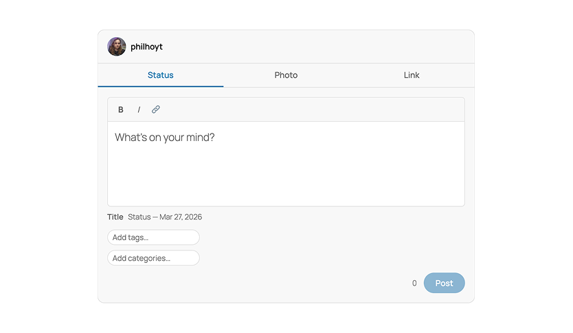

# QuickPostr

[](https://github.com/philhoyt/QuickPostr/actions/workflows/ci.yml)

A front-end post composer block for posting status updates, photos, videos and links without opening wp-admin.



Place the QuickPostr Composer block on a page. Logged-in users in the roles you choose get a composer with Status, Photo, Video and Link modes; everyone else sees nothing. PHP handles authentication, the source taxonomy and title generation; the block's React app handles composing and uploading, and creates posts through the core `/wp/v2/posts` route.

## Requirements

- WordPress 6.7 or later
- PHP 8.1 or later
- A theme with post-formats support. Posts are saved with the status, image, video, gallery and link formats.
- The PHP Imagick extension, only for stripping photo metadata on upload

## Installation

1. Download `quickpostr.zip` from the latest [release](https://github.com/philhoyt/QuickPostr/releases).
2. In WordPress, go to Plugins > Add New > Upload Plugin, choose the zip, and click Install Now, then Activate.
3. Add the QuickPostr Composer block to a page in the block editor.
4. Set who sees it and how posts are created under Settings > QuickPostr.

The zip includes `build/`, so there is no build step. Later releases show up as normal plugin updates through the bundled Plugin Update Checker.

## Usage

### Blocks

| Block | What it does |
|---|---|
| QuickPostr Composer | The composer. Place it once per page. Rendered server-side only for logged-in users in the allowed roles. |
| Post Actions | A menu with Edit and Delete for the current post. Edit opens the post in the WordPress editor. Goes inside a Query Loop template. |
| Like Post | A heart button that records a like and shows the count, for logged-in and logged-out visitors. Goes inside a Query Loop template. |
| Share Post | Calls `navigator.share()` where the browser has it (HTTPS only). Otherwise opens a popover with X, Facebook and Copy link. Goes inside a Query Loop template. |

The QuickPostr Slider block style on `core/gallery` turns a gallery into a scroll-snap slider with dot navigation, arrows and swipe. The "Composer with post feed" pattern (inserter, QuickPostr category) puts the composer above a Query Loop of posts with avatar, date, actions menu, featured image, title, content, and like and share buttons; with GeoTagr active it also shows the location.

### Composer modes

Status: a rich text editor with bold, italic and inline links. A draft is saved 800 ms after the last change and can be resumed later. A blank line starts a new paragraph; the post is stored as Paragraph blocks.

Photo: drag-and-drop upload or the Media Library picker, with optional caption and alt text. The caption feeds the generated title. Several images post a gallery, which can be reordered before posting. A single photo is saved as an Image block in the content, not as a featured image.

Video: drag-and-drop upload or the Media Library picker. The video is embedded as a Video block. With the [VideoMuxr](https://github.com/philhoyt/VideoMuxr) companion plugin active, uploads go to Mux for transcoding and hosted playback.

Link: paste a URL. With [Better Bookmarks](https://github.com/philhoyt/BetterBookmarks) active, the composer fetches Open Graph metadata from `GET /better-bookmarks/v1/preview?url=` and saves a `better-bookmarks/link-card` block. Without it, the post is a Paragraph block with an escaped link and the `link` post format. The Link tab is shown either way.

Every mode has category and tag pickers with typeahead and inline creation, a title field that shows the generated title as its placeholder, and a date control. A past date backdates the post; a future date schedules it, and the composer says so instead of reloading. With [GeoTagr](https://github.com/philhoyt/geotagr) active, a Location button detects the position with the browser Geolocation API or takes a typed address, using GeoTagr's configured geocoding provider.

### Sharing from a phone

Installed as a web app on Android, QuickPostr registers as a share target. Sharing a photo to it opens the Composer Page with that photo loaded. The receiver is `POST /quickpostr-share/`; it accepts images only, refuses cross-site requests, allows 30 shares per user per hour (`quickpostr_share_rate_limit` filter), and deletes uploads that are not attached to a post within 24 hours (`quickpostr_pending_share_ttl` filter).

### Settings

Settings > QuickPostr:

| Setting | Default | Notes |
|---|---|---|
| Show Composer To | administrator, editor, author | Who sees the Composer block. Whether they can publish is decided by WordPress capabilities. |
| Default Post Status | publish | `draft` queues every post for review. |
| Default Category | none | Applied to every new post. |
| Hide Admin Bar | on | Hides the admin bar for roles other than administrator. |
| Hide Admin Bar (Administrators) | off | The same for administrators. |
| Front-End Post Management | on | Turns the Edit and Delete actions in the Post Actions block on or off. |
| Strip Photo Metadata | on | Removes EXIF and XMP from JPEG, PNG and WebP uploads with `Imagick::stripImage()`, after applying EXIF orientation to the pixels. Skipped without a message when Imagick is missing. |
| Composer Page | none | The page holding the Composer block. It is the web app's start page and where shared photos land. |

The page also reports whether GeoTagr and Better Bookmarks are active. Settings are stored in one `wp_options` row, `quickpostr_settings`.

### Post titles

PHP sets the title in `rest_after_insert_post`. The composer sends an empty title and the server fills it in:

- Content of 55 characters or fewer becomes the title.
- Longer content is cut at the last word break before 55 characters and given an ellipsis.
- No content (a photo, video, gallery or link with no caption) gives the format name and the date, for example `Photo` followed by `Mar 26, 2026`.

Generated titles are hidden on the front end through the `the_title` filter and kept in wp-admin and REST responses, so ActivityPub and feed readers get them. A title typed in the composer is shown everywhere.

### Authentication

Every REST request uses cookie authentication with an `X-WP-Nonce` header (`wp_rest` action). Application Passwords are not used. `render.php` prints the nonce with `wp_add_inline_script`, so the composer only works for users who load the page while logged in.

### Taxonomy

A private `quickpostr_source` taxonomy is registered on `post`. Each QuickPostr post gets the term `app` and one of `status`, `photo`, `video` or `link`. It is not publicly queryable and has no admin UI. Use `tax_query` to include or exclude QuickPostr posts:

```php
$query = new WP_Query( [
    'tax_query' => [ [
        'taxonomy' => 'quickpostr_source',
        'field'    => 'slug',
        'terms'    => 'app',
    ] ],
] );
```

### Personal data

Likes are stored as comments: the user account and email for logged-in likers, or the typed name, optional email and a one-way hash of the IP address for logged-out ones. They are included in the personal data exporter and eraser, and the like button remembers liked posts in `localStorage`. Location, with GeoTagr, sends coordinates or a typed place name to the configured geocoder. QuickPostr registers suggested policy text under Settings > Privacy > Policy Guide. Uninstalling removes like records, pending shared uploads, the plugin's post meta, terms, options and transients, and leaves posts alone.

## REST API

Posts are created and edited through the core `/wp/v2/posts` routes, with QuickPostr's meta and taxonomy fields registered on them. The plugin's own `quickpostr/v1` namespace keeps:

| Method | Route | Description |
|---|---|---|
| GET | `/draft` | Fetch the current user's resumable composer draft |
| POST | `/posts/{id}/like` | Toggle a like on a publicly viewable post |
| GET | `/settings` | Read the settings the composer needs |
| POST | `/posts`, `/posts/{id}` | Deprecated since 0.17.0 in favour of `/wp/v2/posts`; removed in 1.0.0 |

## Development

```bash
npm install
composer install

npm run build        # production build
npm start            # webpack watch
npm run lint:js      # ESLint on src/blocks, src/gallery-slider and tests/e2e
npm run lint:css     # Stylelint on src/blocks/**/*.css
npm run test:unit    # Jest
npm run pot          # regenerate languages/quickpostr.pot (needs WP-CLI)

composer lint             # phpcs (WPCS)
composer lint:fix         # phpcbf
composer analyse          # PHPStan
composer test             # PHPUnit unit suite: Brain Monkey, no WordPress, no database
composer test:integration # PHPUnit against WordPress and a database, inside wp-env
composer test:all         # both suites
composer test:coverage    # integration suite with line coverage (wp-env with Xdebug)
```

The integration and E2E suites run in [`@wordpress/env`](https://www.npmjs.com/package/@wordpress/env) and need Docker. There are two environments on purpose: `WP_UnitTestCase` drops every table in the database it connects to, so PHPUnit never shares the E2E site.

```bash
npm run env:start          # WordPress 7.1.3 on http://localhost:8888 with the plugin active
npm run test:e2e           # Playwright specs in tests/e2e/specs (starts the environment if needed)
npm run env:stop

npm run env:phpunit:start  # a second environment on :8890 for PHPUnit
composer test:integration
npm run env:phpunit:stop
```

If another wp-env project holds those ports, set `port` in the gitignored `.wp-env.override.json` and `.wp-env.phpunit.override.json`, and run E2E with `WP_BASE_URL=http://localhost:<port> npm run test:e2e`.

CI runs phpcs, PHPStan and the unit suite on PHP 8.1 through 8.5, then builds the assets and runs the integration suite in wp-env.

## Releases

Bump the version in `quickpostr.php` (header and `QUICKPOSTR_VERSION`), `package.json`, every `src/blocks/*/block.json` and the readme.txt `Stable tag`, add the changelog entry to readme.txt, then push a `v`-prefixed tag:

```bash
git tag v0.20.1 && git push origin v0.20.1
```

The [release workflow](.github/workflows/release.yml) installs JS dependencies, runs `npm run build` and `npm run plugin-zip`, takes the matching `= X.Y.Z =` section of readme.txt as the release notes, and creates a GitHub release with `quickpostr.zip` and `readme.txt` attached. Installed sites get the update through Plugin Update Checker reading those assets.

## Limitations

- The composer renders nothing for logged-out visitors; there is no login prompt.
- Editing an existing post from the front end opens the WordPress editor. The composer only creates posts.
- Metadata stripping covers JPEG, PNG and WebP, and only with Imagick. HEIC, GIF and AVIF uploads keep their metadata.
- The share target works where the browser supports web app share targets, which today means Chrome on Android.
- The `/quickpostr/v1/posts` endpoints are deprecated and will be removed in 1.0.0.
